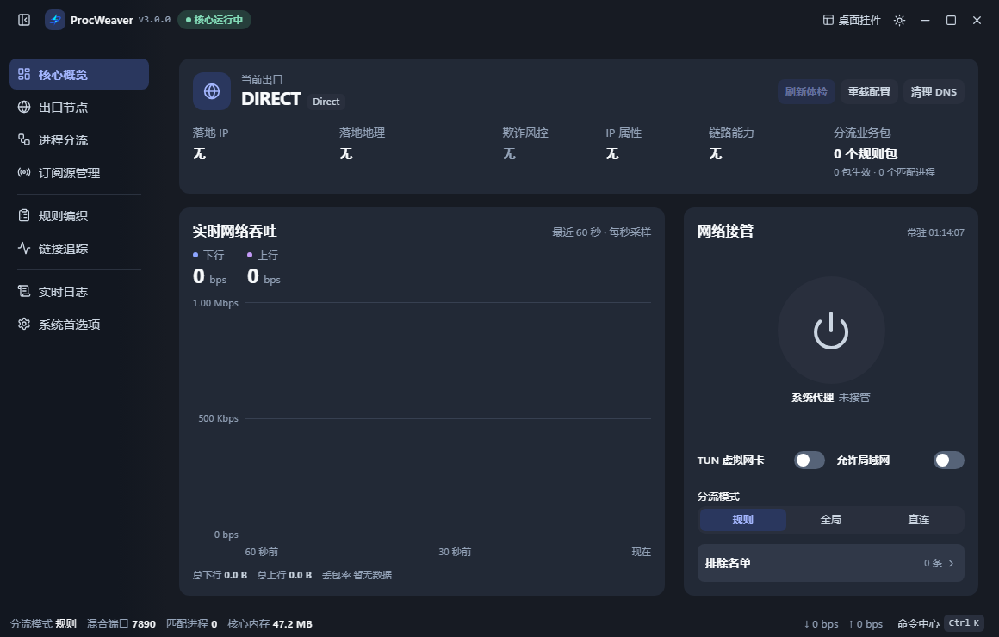
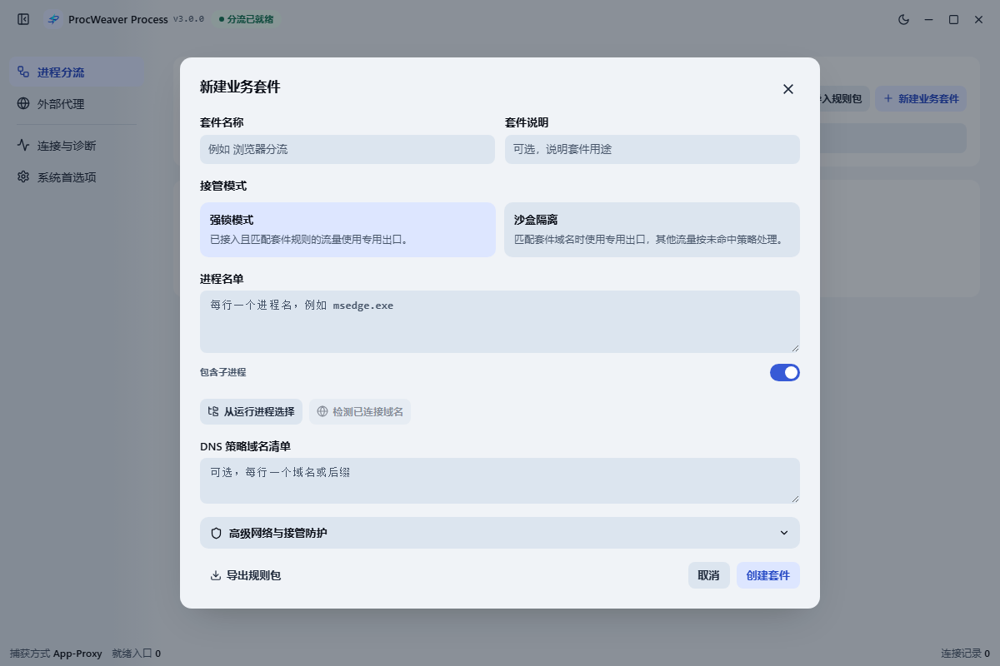
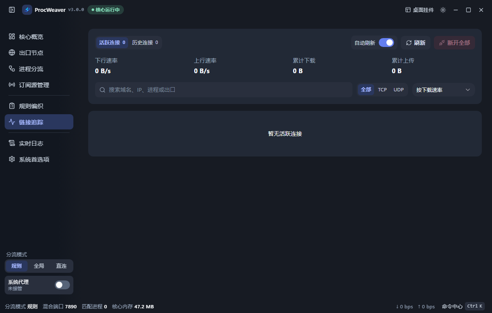
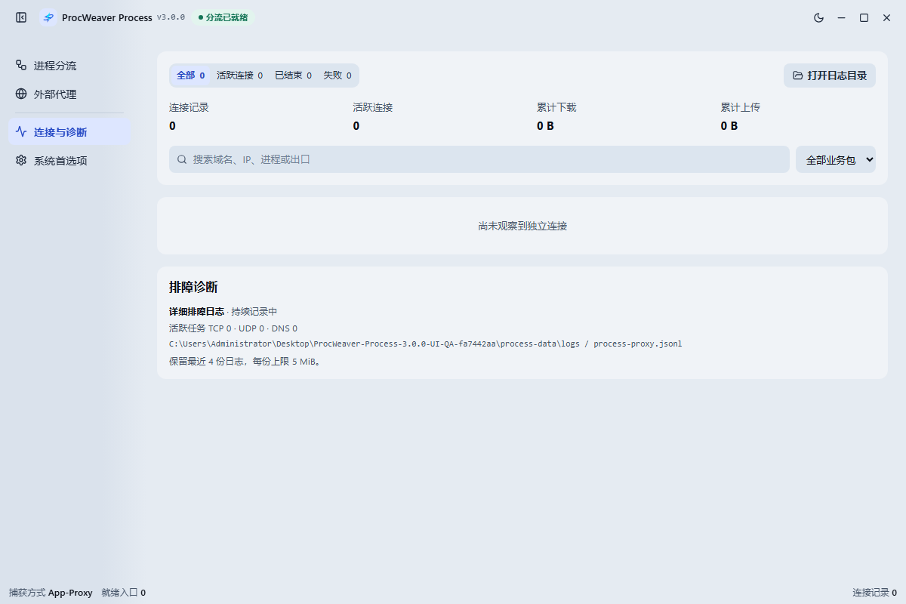
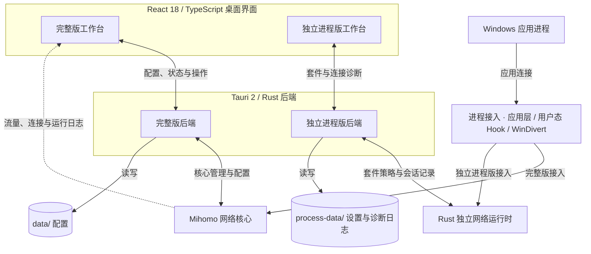

# ProcWeaver

**Windows 网络调试工具 · v3.0.1**

ProcWeaver 用于观察 Windows 应用的联网行为。你可以查看某个进程连接了哪些域名和端口、上传和下载了多少数据，以及连接是正常结束还是在解析、建立连接或传输时遇到问题。调试多个应用时，可以用进程套件限定要处理的进程、目标和端口。

## 软件截图

| 完整版 | 独立进程版 |
| :---: | :---: |
|  核心概览 |  新建业务套件 |
|  链接追踪 |  连接与诊断 |

## 下载与启动

| 版本 | 适用场景 | 启动程序 | 已发布的 v3.0.0 Windows x64 绿色便携包 |
| --- | --- | --- | --- |
| 完整版 | 结合实时流量、活跃与历史连接、规则试算和运行日志综合排障。 | `ProcWeaver.exe` | [下载完整版](https://github.com/yunyin-boy/ProcWeaver/releases/download/v3.0.0/ProcWeaver_v3.0.0_x64_Portable.zip) |
| 独立进程版 | 围绕指定应用或进程套件，查看连接记录、失败信息和本地诊断日志。 | `ProcWeaverProcess.exe` | [下载独立进程版](https://github.com/yunyin-boy/ProcWeaver/releases/download/v3.0.0/ProcWeaverProcess_v3.0.0_x64_Portable.zip) |

将 ZIP 完整解压到一个可写目录后，运行上表对应的程序。首次打开完整版时，按界面提示阅读并确认使用说明。

完整版的便携配置位于 `data/`，独立进程版首次运行时会创建 `process-data/` 保存设置和日志。更新日志、对应源码和 SHA-256 校验文件可在发布页查看。[v3.0.0 发布页](https://github.com/yunyin-boy/ProcWeaver/releases/tag/v3.0.0)

## 完整版

### 核心概览

页面每秒采样一次上下行速率，显示最近 60 秒的曲线和累计传输量。复现问题时，可以同时观察请求发出、响应到达和传输结束时的变化。

「网络接管」卡片集中显示 TUN 虚拟网卡、局域网访问和分流模式，并可打开排除名单。页面顶部可重载配置或清理 DNS 缓存，便于修改设置后再次测量。

### 链接追踪

- **活跃连接**显示当前速率、传输量、协议和连接时长。可开启自动刷新，按下载或上传速率排序，找出正在传输的连接。
- **历史连接**保留最多 500 条采样检测到的断开记录，支持按断开时间或传输量排序，方便在请求结束后回查。
- **搜索与筛选**可同时使用域名、IP 或进程关键字和 TCP、UDP 筛选。打开一条记录可核对目标地址与端口、本地源地址、建立时间、规则命中和上传下载量。来源数据提供进程路径或 DNS 策略时，详情也会显示。
- **重新观察连接**可从详情断开一条活跃连接，再在应用里重新发起请求，查看新连接的实际规则命中或速率。

### 规则编织

在「分流规则」中可以按顺序查看规则的类型与匹配条件。「路由试算」接受域名或 IP，按列表顺序计算可能命中的规则，并显示规则类型、顺序和原因。请求实际发出后，在「链接追踪」的详情中核对运行时命中。

「进程分流」页还提供「自定义进程」和「运行进程」。前者可针对单个可执行文件名或完整路径配置规则，后者可查看当前运行的进程，确认实际执行联网操作的程序名。

### 实时日志

- **缩小查询范围**可按错误、警告、信息、调试级别筛选，也可输入消息关键字或时间片段。
- **保留现场**可关闭「跟随最新」来查看较早的记录，或使用「暂停显示」固定当前画面。日志界面最多缓存 2,000 条近期记录。
- **带走排障结果**可复制单条日志，或使用「导出结果」把当前筛选后的记录保存为文本文件。

### 系统首选项与桌面挂件

- **系统首选项**集中管理应用与窗口、网络与连接、DNS、更新与维护。可配置 IPv6、解析模式、DNS 服务器和 Hosts 优先级，也可在「更新与维护」导出或恢复配置快照。
- **桌面挂件**可从标题栏打开。置顶后可以边操作被测应用，边查看实时流量，在「进程分流」管理套件，或从「急救工具」进行网络修复和核心重启。
- **快捷操作**可收起侧栏，只保留页面图标。按 `Ctrl+K` 打开命令中心，可直接找到「核心概览」「链接追踪」「实时日志」或清理 DNS 操作。

## 独立进程版

### 连接与诊断

页面汇总记录总数、活跃连接数、累计上传和累计下载。可以先选定套件，再按「活跃连接」「已结束」「失败」筛选，并用进程名、PID 或目标地址进一步搜索。

每条记录显示目标地址、进程、PID、时间和传输量。遇到失败时，先看记录中的诊断信息，再用「打开日志目录」查看对应时段的本地日志。启用 WinDivert 时，「排障诊断」还会显示 TCP、UDP、DNS、未识别和失败计数，可用来判断问题是否出现在捕获阶段。

### 系统首选项

可设置开机自启、启动时隐藏主窗口，以及关闭窗口时退出或最小化到托盘。长时间复现偶发断线时，可把窗口收起，待问题出现后再打开「连接与诊断」查询。

## 进程分流

两个版本均可在「进程分流」为应用创建业务套件。套件将一组可执行文件和调试规则保存在一起，适合重复检查同一应用的联网行为。

### 创建与启动套件

1. 点击「新建业务套件」，填写名称，在「进程名单」中逐行填写可执行文件名，或用「从运行进程选择」添加程序。
2. 应用使用独立的网络进程或辅助进程时，按需开启「包含子进程」。设置目标、端口及 DNS 范围后保存套件。
3. 完成套件配置后打开「进程捕获」和「启用套件」。需要受控启动时，使用套件卡片的「启动」，再到对应的诊断页面核对新连接。

### 捕获方式

| 方式 | 使用场景 |
| --- | --- |
| 应用层 | 使用套件启动应用，通过应用能够识别的联网启动参数接入。 |
| 用户态 Hook | 受控启动时从进程内接入，适合需要检查应用及其子进程的联网行为。 |
| WinDivert | 在 Windows 驱动层捕获并按进程归属处理流量。启用驱动需要管理员权限。 |

### 调试范围与连接策略

| 设置 | 用法 |
| --- | --- |
| 强锁与沙盒 | 强锁对已接入且匹配套件规则的连接应用套件策略。沙盒按指定范围命中，其余目标遵循所选的未命中策略。完整版还可使用现有规则做沙盒分流。 |
| 端口过滤 | 可处理全部端口、仅 Web 端口 `80` 和 `443`，或指定单个端口和区间，例如 `8443`、`3000-3010`。 |
| 目标过滤 | 用域名、IP 或网段限定匹配范围。白名单用于只处理匹配项，黑名单用于排除匹配项。 |
| DNS 解析 | 可按套件配置域名清单与可用的解析模式。安全纯净解析返回真实 IP，Fake-IP 先分配临时地址并在建立连接时恢复域名，系统原生解析使用 Windows 配置的 DNS。 |
| 局域网例外 | 「本地回环与局域网直连绕过」用于保留应用对本机服务与内网地址的直接访问。 |
| 已建立的 TCP 连接 | 可选择「智能询问」「自动热刷新」或「仅接管新连接」。验证改动时，可按所选策略区分既有长连接和随后建立的连接。 |

### 导入、导出与复用

通过「导入规则包」读取本地 `.pwpack.json`，也可在「GitHub 业务包」中管理仓库并用「下载并挂载」添加套件。套件卡片的「导出」可把进程定义和规则保存为规则包，方便在其他环境中复用并调整。

## 技术架构

完整版与独立进程版各有桌面入口、后端运行时和便携数据目录。图中的两条分支分别对应 `ProcWeaver.exe` 与 `ProcWeaverProcess.exe`。

| 模块 | 职责 |
| --- | --- |
| 桌面界面 | 展示实时流量、连接、套件和日志，通过 Tauri 命令提交配置和触发操作。 |
| 完整版网络核心 | Rust 后端管理 Mihomo 进程和配置。工作台通过本机控制接口读取流量、连接、规则和运行日志。 |
| 独立进程版运行时 | Rust 按套件匹配已接入的连接，处理 DNS 和连接转发，生成会话状态、传输量和失败信息。 |
| Windows 捕获 | 接入目标进程的流量，识别归属并将连接交给对应版本的运行时。完整版还可通过 TUN 虚拟网卡接入。 |
| 本地数据 | 完整版在 `data/` 保存便携配置。独立进程版的设置和诊断日志位于 `process-data/`，可从应用中打开日志目录。 |

## 常见排障步骤

### 应用连接超时或失败

1. 重现一次失败，记下进程名称、操作时间、目标域名和端口。
2. 在独立进程版选定套件和「失败」，或在完整版查看「链接追踪」中的活跃、历史记录。应用有多个同名进程时，用 PID 或进程路径确认对应记录。
3. 按时间查对应日志。如果域名解析失败，核对 DNS 模式和域名清单。如果连接已建立但数据一直不增长，检查后续传输记录与关闭原因。

### 一段时间内流量突然升高

1. 在「核心概览」观察上下行曲线，记下速率升高的时间。
2. 在「链接追踪」按下载或上传速率排序，打开高流量连接检查来源进程与目标。传输已经结束时，按累计传输量或断开时间查看历史。
3. 在应用中重试相同操作，结合实时日志核对流量变化是否与该操作同步。

### 修改规则后仍看到旧行为

1. 在「规则编织」查看规则顺序，对目标域名或 IP 运行「路由试算」。
2. 核对套件中的目标、端口和局域网例外。另起一次连接，确认它的建立时间在修改之后。
3. 在连接详情中检查实际命中。长连接仍保持时，按套件的旧连接处理策略刷新，或在应用中重连后再次核对。

### 切换 DNS 设置后解析结果不同

1. 记下目标域名、套件的 DNS 模式和是否命中域名清单，查看日志中是否有解析失败。
2. 修改解析设置后，可从完整版「核心概览」清理 DNS 缓存。让被测应用为同一域名建立一次新连接。
3. 对照修改前后的解析结果、连接目标及错误信息，确认变化出现在域名解析还是后续建连阶段。

## 许可与反馈

ProcWeaver 按 [AGPL-3.0-only](LICENSE) 开源。

反馈问题时可附上软件版本、Windows 版本、捕获方式、应用进程名、问题时间和复现步骤，以及去掉个人信息后的相关日志。[GitHub Issues](https://github.com/yunyin-boy/ProcWeaver/issues) · [社区交流](https://linux.do/t/topic/2940957)
